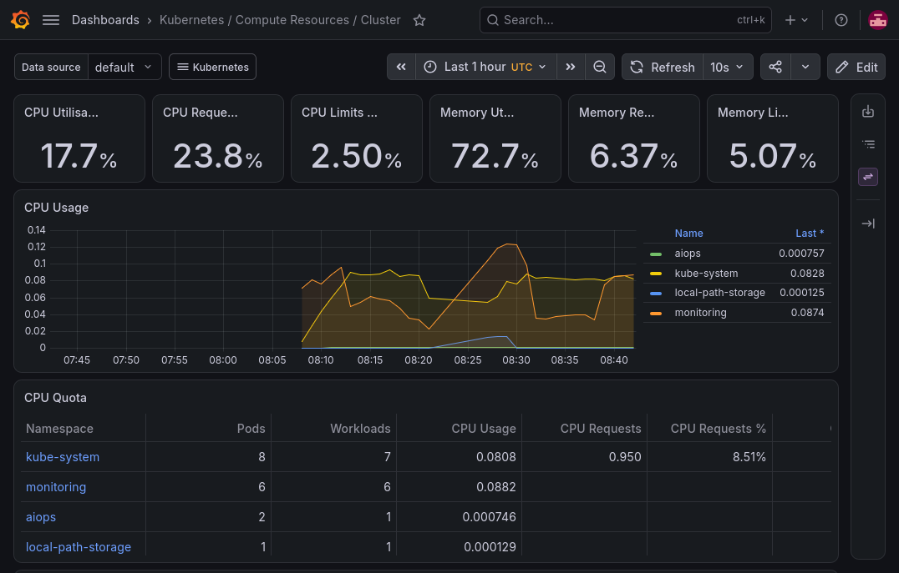
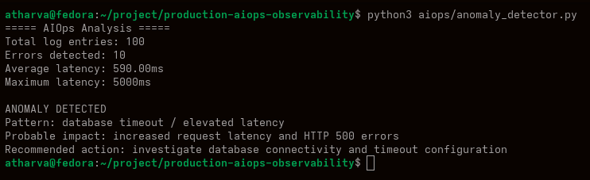
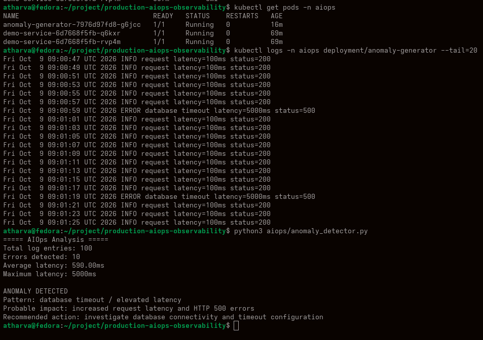

# Production Observability & AIOps Platform

**Kubernetes · Prometheus · Grafana · Python · AIOps · kind**

A production-style observability platform that combines Kubernetes metrics, application logs, and Python-based analysis to detect anomalies, correlate symptoms into incidents, and support faster root cause analysis.

## Architecture

```text
Application (Kubernetes)
→ Metrics → Prometheus → Grafana
→ Logs → kubectl logs
→ Python AIOps Engine
→ Anomaly Detection + Incident Correlation
→ Root Cause Analysis + MTTD / MTTR
```

## What I Built

- Deployed a demo application and a log-anomaly generator on a local kind Kubernetes cluster.
- Implemented cluster and workload monitoring using Prometheus and Grafana (kube-prometheus-stack).
- Built a Python anomaly detector that parses application logs for errors and latency spikes.
- Built an incident analyzer that correlates database timeouts, HTTP 500s, and high latency into a single incident.
- Simulated a CPU saturation event and observed it through Grafana and `kubectl top`.
- Documented the investigation in a structured incident report with MTTD / MTTR measurement.

## Incident Workflow

**DETECT → COLLECT → CORRELATE → INVESTIGATE → REMEDIATE → VERIFY**

## 1. Monitoring Baseline



Grafana showing the healthy Kubernetes cluster before any failure is introduced.
Cluster CPU utilisation sits at 17.7%, and the `aiops` namespace is using almost no CPU (about 0.0008 cores). This is the baseline used to judge abnormal behavior.

## 2. Python Anomaly Detection



The Python AIOps engine analyzing the last 100 log entries from the anomaly generator.
It detected 10 errors, an average latency of 590ms, and a maximum latency of 5000ms. It flagged a database timeout / elevated latency pattern and recommended investigating database connectivity and timeout configuration.

## 3. CPU Saturation Observed in Grafana



Grafana showing the `aiops` namespace CPU climbing to about 0.98 cores during the simulated CPU stress.
Cluster CPU utilisation rises from 17.7% to 43.2%, and the spike is clearly visible against the other namespaces. This shows how metrics expose resource-level problems that logs alone would not.

## 4. End-to-End Investigation


The full investigation in one view: pod health, live application logs, and the AIOps result.
`kubectl get pods` confirms the workloads are running, the logs show periodic `ERROR database timeout latency=5000ms status=500` entries among normal traffic, and the Python engine turns them into a clear anomaly finding.

## Failure Scenarios Simulated

- Elevated latency
- HTTP 500 errors
- Database timeout
- High CPU

## Key Learning

- Production observability principles
- Metrics, logs, and alert correlation
- Prometheus and Grafana monitoring on Kubernetes
- Python-based log analysis and anomaly detection
- Incident correlation and Root Cause Analysis
- MTTD / MTTR-focused incident investigation
- End-to-end workflow: **DETECT → COLLECT → CORRELATE → INVESTIGATE → REMEDIATE → VERIFY**
